<div align="center">

# 🌡️ ThermoGAT

### Teaching a graph neural network to read the heat-map of a diabetic foot — and to tell you when it isn't sure.

**Physics-informed dual-branch Graph Attention Network for diabetic foot screening from plantar thermography**

<br/>


<br/>

[**The idea**](#-the-idea-in-plain-words) · [**Results**](#-results-the-short-honest-version) · [**How it works**](#-how-it-works) · [**Explainability**](#-what-the-model-looks-at) · [**Limits**](#-the-honest-part-limitations) · [**Run it**](#-run-it-yourself) · [**Glossary**](#-plain-english-glossary)

</div>

---

## ⚡ TL;DR

A diabetic foot gets **hotter and more uneven** before ulcers show up. ThermoGAT turns a foot's thermal image into a **tiny 4-node graph** (one node per blood-supply region of the sole), reads it with an **edge-aware graph attention network** plus a small CNN, and reports **both a prediction and how unsure it is**.

On its own the model is about as good as the classic clinical heat score (TCI). **Averaged together with TCI models, it is significantly better than TCI alone.** And its attention lands on the same heel region (MCA) that a separate published method found. This repo also documents, openly, everything that *didn't* work and the one big confound hiding in the dataset.

| 🧑‍🤝‍🧑 Subjects | 🦶 Feet | 🕸️ Graph size | 🎯 Final AUC | 📉 Calibration (Brier) | 🔁 Seeds tested | 🧪 Notebooks |
|:---:|:---:|:---:|:---:|:---:|:---:|:---:|
| **167** (45 Control / 122 DM) | **334** | **4 nodes / foot** | **0.890** | **0.134** vs 0.159 (TCI) | **4** | **25** |

---

## 🧠 The idea, in plain words

**The problem.** Diabetes can damage nerves and blood vessels in the foot. Damaged tissue often runs *warmer* and *patchier* than healthy tissue. A thermal camera captures this as a grid of temperatures. The usual clinical shortcut is the **Thermal Change Index (TCI)** — one number per foot. One number is simple, but it throws away *where* on the foot the heat is.

**The twist.** The sole of the foot is fed by four blood-supply zones called **angiosomes**. This project keeps those zones separate and treats them like a small network:

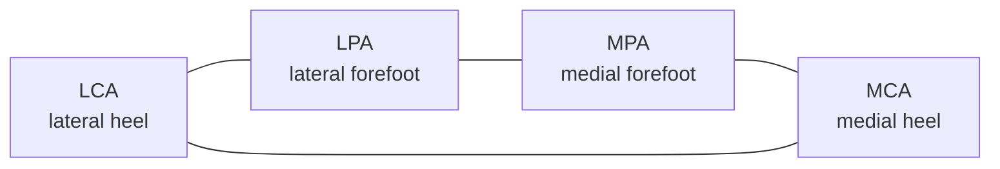

Each zone is a **node** holding its temperature stats and position. Each neighbouring pair is an **edge** holding how far apart they are and how much their temperatures differ (the "heat flows between neighbours" idea — the *physics-informed* part). A **graph attention network (GAT)** then learns which zones to listen to.

> [!NOTE]
> "Physics-informed" here means the graph and its edge features encode anatomy and thermal gradients. A later ablation (below) showed the *accuracy* is surprisingly robust to those exact choices — the value of the graph turned out to be more about **what it learns** (interpretability) than a big AUC jump. This README says so plainly.

---

## 🏆 Results (the short, honest version)

### Headline: fusion beats the clinical biomarker, with receipts

| Model | ROC-AUC | Notes |
|---|:---:|---|
| TCI alone (Logistic Regression, worse foot) | 0.859 | Strong, simple baseline |
| DualBranchGAT alone | 0.882 ± 0.056 | 5-fold patient-level CV (pooled 0.878) |
| **3-way fusion: GAT + LR-TCI + AdaBoost-TCI** | **0.890** | Simple unweighted average — **the headline model** |

- **Statistically significant vs TCI alone:** DeLong p = **0.0194** (paired, same 167 subjects).
- **Robust across random splits:** the 2-way fusion over 4 independent seeds gave AUC **0.891 ± 0.006**, significant in **3 of 4** seeds (the 4th, p = 0.108, had the same direction and size — a power issue, not a reversal).
- **Fusion vs GAT alone is *not* significantly different** (p = 0.80 for 3-way vs 2-way, p = 0.40 for 2-way vs GAT). We don't claim otherwise.
- **Why the simple average won:** with only 167 subjects, anything with extra parameters to fit (tuned weights, a stacked meta-model) did slightly worse.

<div align="center">

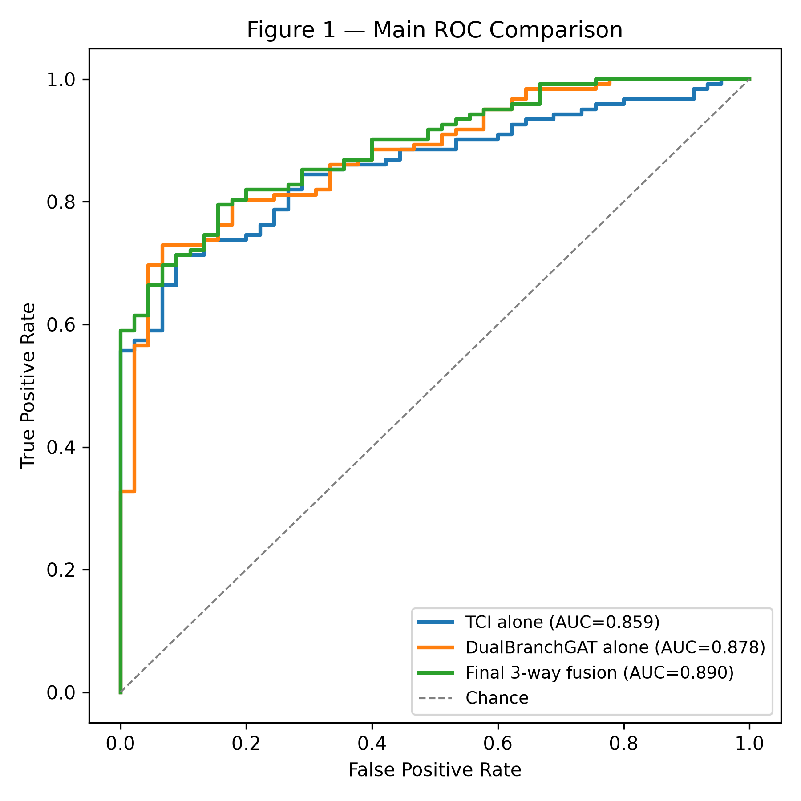

*Fig 1 — ROC curves: TCI alone vs GAT alone vs final fusion.*

</div>

### Operating-point metrics (final fusion, all 167 subjects, out-of-fold)

| Threshold | Balanced acc. | F1 | Accuracy |
|---|:---:|:---:|:---:|
| CV-derived (Youden's J per fold) — *reported as primary* | 0.792 | 0.834 | 0.778 |
| Flat 0.5 cutoff — *secondary* | 0.810 | 0.866 | 0.814 |

Confusion matrix at the CV threshold: **37 / 45 Controls** and **93 / 122 DM** correct (specificity 0.82, sensitivity 0.76). PR-AUC is **0.960** against a no-skill line of 0.731.

<details>
<summary><b>📊 Per-fold results for DualBranchGAT (click to expand)</b></summary>

| Fold | n | ROC-AUC | Balanced acc. | F1 | Accuracy |
|:---:|:---:|:---:|:---:|:---:|:---:|
| 0 | 34 | 0.956 | 0.869 | 0.941 | 0.912 |
| 1 | 34 | 0.822 | 0.556 | 0.862 | 0.765 |
| 2 | 33 | 0.843 | 0.750 | 0.851 | 0.788 |
| 3 | 33 | 0.926 | 0.875 | 0.857 | 0.818 |
| 4 | 33 | 0.866 | 0.729 | 0.826 | 0.758 |
| **Mean ± std** | | **0.882 ± 0.056** | 0.756 ± 0.130 | 0.868 ± 0.043 | 0.808 ± 0.063 |

The earlier single 70/15/15 split (AUC 0.857) falls inside this range, so it wasn't a lucky draw. The wide spread in balanced accuracy comes from threshold picking on ~14-subject validation sets — ranking quality (AUC) stayed solid in every fold.

</details>

<details>
<summary><b>🧾 Master comparison table (click to expand)</b></summary>

| Model | Category | ROC-AUC |
|---|---|:---:|
| **3-way fusion (headline)** | final | **0.890** pooled · 0.891 ± 0.006 multi-seed |
| DualBranchGAT (dual-branch) | primary | 0.882 ± 0.056 |
| Graph-only · diagonal_only | structure ablation | 0.887 ± 0.052 |
| Graph-only · base_real (anatomical 4-cycle) | structure ablation | 0.883 ± 0.052 |
| Graph-only · selfloop_only | structure ablation | 0.883 ± 0.056 |
| Graph-only · base_no_edgefeat | structure ablation | 0.874 ± 0.055 |
| Bilateral (both feet, 8-node) graph | bilateral | 0.879 ± 0.053 |
| LR · worse-foot TCI | TCI baseline | 0.859 pooled |
| AdaBoost · both-feet TCI | TCI baseline | 0.838 pooled |
| LR · both-feet TCI | TCI baseline | 0.828 pooled |
| AdaBoost · worse-foot TCI | TCI baseline | 0.825 pooled |

Fold-mean ± std is the standard k-fold convention; "pooled" means one out-of-fold prediction per subject, concatenated.

</details>

### 🧩 The two models make *different* mistakes

Looking at which subjects each model gets right:

| Group | Subjects | What it means |
|---|:---:|---|
| Both correct | 116 (69.5%) | Easy cases |
| **GAT only correct** | 19 (11.4%) | 18 of 19 are **DM** — the GAT is the better *DM-catcher* (sensitivity 0.87) |
| **TCI only correct** | 11 (6.6%) | 9 of 11 are **Control** — TCI is the better *rule-out* tool |
| Both wrong | 21 (12.6%) | Hard cases |

That complementarity is exactly why averaging them helps.

---

## 🛠️ How it works

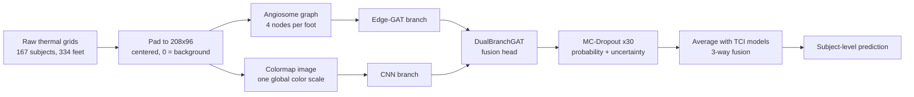

### 1 · The data
**Plantar Thermogram Database** (Hernández-Contreras et al., INAOE Mexico — [IEEE Access 2019](https://doi.org/10.1109/ACCESS.2019.2951356), [dataset DOI 10.21227/tm4t-9n15](https://doi.org/10.21227/tm4t-9n15)). 45 control + 122 diabetic subjects; per foot a raw temperature CSV (°C, `0` = no tissue) plus four angiosome masks (LCA, LPA, MPA, MCA).

Things this project verified instead of assuming:
- Grid sizes **vary** (height 103–200 px, width 41–88 px), so everything is padded to a fixed **208 × 96** canvas, centered.
- Angiosome files are true sub-masks of the full foot (1,336 / 1,336 checks pass, before *and* after padding).
- Our computed region averages match the dataset's own Excel values to within **0.0000048 °C** across all 1,336 comparisons.
- One stray `logo.png` explained the "extra PNG" file-count mystery.

### 2 · The graph (per foot)
| Piece | Contents |
|---|---|
| **Nodes (4)** | `mean_abs_temp`, `std_abs_temp`, `mean_rel_temp`, `pixel_count`, `centroid_row_norm`, `centroid_col_norm` (position measured inside each foot's own bounding box, so it's comparable across people) |
| **Edges** | Anatomical 4-cycle LCA–LPA–MPA–MCA. Features: centroid distance + temperature gradient. A diagonal-augmented variant is also saved for ablation. |
| **Relative temps** | Each foot's own mean is subtracted, because the EDA found absolute temperatures across regions are 81–99 % correlated (overall body heat dominates) |

### 3 · The model — `DualBranchGAT` (34,433 parameters)

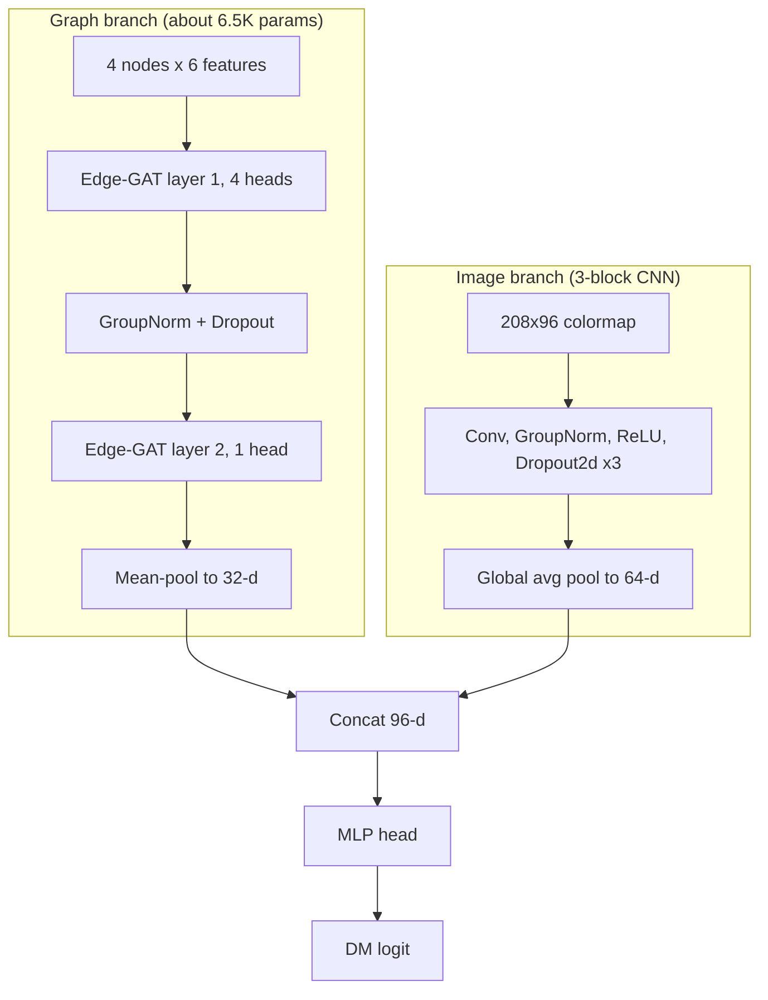

Design choices worth knowing:
- **GroupNorm, never BatchNorm** — Monte-Carlo Dropout needs dropout alive at inference, often on tiny batches, and BatchNorm statistics misbehave there.
- **No PyTorch Geometric.** Every graph has exactly 4 nodes, so graphs are plain dense tensors and the default PyTorch collate works.
- **Class imbalance (2.7 : 1 DM)** handled with `pos_weight` set to **DM's own (smaller) inverse-frequency weight** — a classic easy-to-flip mistake we explicitly guarded against.
- **Subject-level answers.** Both feet of a person are always in the same fold, and their probabilities are averaged — because the clinical question is about the *person*.

### 4 · Evaluation protocol
- **Patient-level, stratified 5-fold CV** (same folds reused for GAT, TCI baselines, fusion and every DeLong test, so all comparisons are paired).
- Normalization stats computed from **training data only**.
- Thresholds chosen on **validation** data only (Youden's J).
- **MC-Dropout, T = 30** — validated on an untrained model first (mechanism only), then used on trained ones.

---

## 🔍 What the model looks at

We extracted the GAT's learned attention weights (recomputed from the trained layer weights, verified to sum to 1.0 with max error 1.2 × 10⁻⁷) and measured how much "attention mass" each region receives.

| Region | Control | DM | p (Mann-Whitney) |
|---|:---:|:---:|:---:|
| LCA (lateral heel) | 0.231 | 0.221 | 1.2 × 10⁻² |
| LPA (lateral forefoot) | 0.259 | 0.281 | 7.8 × 10⁻⁶ |
| MPA (medial forefoot) | 0.245 | 0.265 | 5.4 × 10⁻⁴ |
| **MCA (medial heel)** | **0.265** | **0.233** | **3.5 × 10⁻⁹** |

In diabetic feet, attention **shifts away from the heel and toward the forefoot**, with the **Medial Calcaneal Artery (MCA)** showing by far the strongest separation. A separately published graph approach (k-GCNDFU, 2026 — different graph design, different explainer) also pointed at MCA. Two independent methods converging on one anatomical region is a nice piece of cross-validation.

<div align="center">

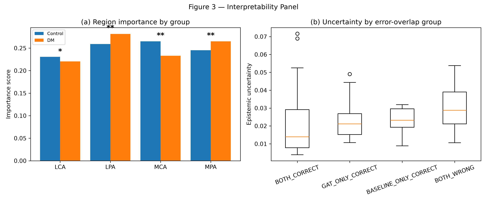

*Fig 3 — (a) Region attention by group. (b) Uncertainty by error group.*

</div>

---

## 🎚️ Knowing when it doesn't know

MC-Dropout gives each prediction an **epistemic-uncertainty** score. Does that score mean anything?

- Subjects **both models got wrong** carry ~55 % higher uncertainty than subjects both got right (0.030 vs 0.020, Mann-Whitney **p = 0.0002**).
- **Triage test:** defer the most-uncertain half of subjects to a human, and accuracy on the confident half rises to **0.940**, versus **0.807** for a random half.

| Cases kept (most confident first) | Uncertainty-based accuracy | Random-rejection accuracy |
|:---:|:---:|:---:|
| 100 % | 0.808 | 0.808 |
| 80 % | 0.828 | 0.807 |
| 70 % | 0.855 | 0.805 |
| 60 % | 0.900 | 0.810 |
| 50 % | 0.940 | 0.807 |

(At 90 % kept it is a statistical tie with random — too small a slice to matter.) The model is also **better calibrated** than TCI: Brier **0.134** vs **0.159** (lower is better).

---

## ⚠️ The honest part: limitations

> [!WARNING]
> **A three-number demographics model beats every thermal model here.**
> A logistic regression using only **age, gender and BMI** reaches **AUC 0.978** (n = 140 complete-case), above TCI (0.859) and the fusion model (0.890).

**Why:** the dataset's two groups are separated by age almost as cleanly as by diagnosis — Control median age **25.0**, DM median age **55.5**, likely a "young healthy volunteers vs older patients" recruitment pattern. Gender is also imbalanced (Control 64 % male, DM 27 % male).

**What we checked, and what it showed:**

| Check | Result |
|---|---|
| Does model confidence drift with age/BMI *within* a diagnosis class? | **No** (all p > 0.15) — reassuring |
| Gender subgroups | Female AUC 0.911, Male AUC 0.866 — no collapse |
| Age-overlap subset (ages 23–52, n = 79) | Demographics 0.940, Fusion 0.899, GAT 0.873, TCI 0.858 — demographics **still win**, the confound is reduced but **not removed** (16-year mean age gap remains) |
| Degradation from easy → hard subset | Demographics −0.061, GAT −0.065, TCI −0.043, Fusion −0.041 — TCI and fusion degrade a bit *less*, a modest second-order signal, **not** a "thermal beats demographics" result |
| BMI-atypical subjects | Accuracy 0.70 vs 0.80 for typical subjects — some demographic reliance likely |

**The claim we are comfortable making:** fusion beats TCI alone (both are thermal-derived, so demographics can't explain that gap). **The claim we are *not* making:** that these models outperform demographics, or are ready for clinical use.

Other known limits: only 167 subjects; 27 DM subjects lack weight/height/BMI (deliberately **not** imputed, since per-group imputation would leak the label); a single dataset with no external validation; fold-wise normalization was not re-derived per fold.

<div align="center">

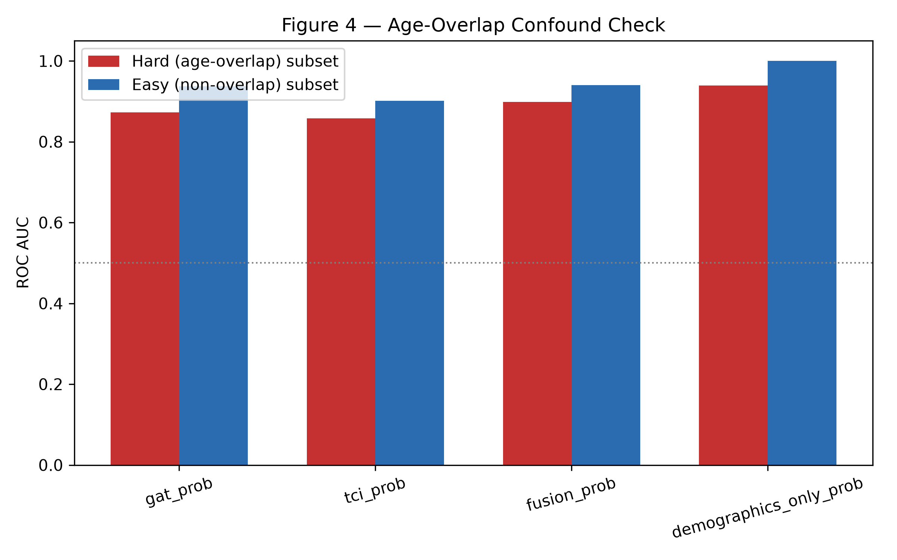

*Fig 4 — AUC on the age-overlap ("hard") vs non-overlap ("easy") subsets.*

</div>

---

## 🧪 Experiments that came back null (and why they still matter)

| Experiment | Result | Takeaway |
|---|---|---|
| **Structure ablation** — real 4-cycle vs no edges vs diagonals-only vs zeroed edge features | All four within a 0.013 AUC band, inside the ~0.05 fold noise | The 4-region *decomposition* matters more than the exact edge engineering |
| **Bilateral graph** — 8 nodes, with cross-foot "mirror" edges carrying L–R asymmetry | 0.879 ± 0.053 vs 0.883 for independent feet | The EDA's asymmetry signal (DM 0.71 °C vs Control 0.32 °C, p = 0.003) is real but already captured |
| **Diagonal adjacency** | No clear gain over the confirmed 4-cycle | Keep the anatomical default |
| **Image source** (colormap / raw / relative) | Relative-only image was worst alone, but fine *with* the graph | The graph's absolute-temperature features cover what relative images drop |

Two independent architecture experiments both said the same thing, so architecture search was stopped on purpose rather than endlessly tweaked.

---

## 🧾 Rigor receipts

- ✅ **Zero patient-level leakage** — verified at the split, dataset and fold levels.
- ✅ **Test split touched exactly twice**, both declared up-front (final evaluation, then a single-pass ablation); all later claims use cross-validation instead.
- ✅ **Paired DeLong tests** on identical subjects and identical folds.
- ✅ **Multi-seed** replication (seeds 42, 7, 123, 2024; 23 minutes total runtime for 20 fresh trainings).
- ✅ **Self-corrections kept in the record:** a wrong adjacency-mask count in a spec (12, not 8), an over-optimistic auto-generated summary on the age-overlap test, a duplicated model row in the master table, and a "± 0.013" that was secretly a std across five *different* models. All were caught and fixed.
- ✅ **Known run-to-run noise documented:** MC-Dropout drawn from a different RNG state moved AUC by ~0.02–0.03 on identical weights — that's the estimator's noise floor.

---

## 🗂️ Repo map

```text
ThermoGAT/
├── notebooks/                    # 25 numbered notebooks = the whole story, in order
│   ├── 01_data_loading_integrity.ipynb
│   ├── ...
│   └── 25_final_consolidation.ipynb
├── src/                          # reusable, validated building blocks
│   ├── dataset.py                # PlantarThermographyDataset + dataloader builders
│   ├── model.py                  # EdgeGATLayer, GraphBranch, ImageBranch, DualBranchGAT
│   ├── mc_dropout.py             # enable_mc_dropout, mc_dropout_predict (T=30)
│   └── train.py                  # build_model, train_one_epoch, evaluate, train_model
├── data/processed/               # manifests, padded arrays, graphs (.npz), split files
├── checkpoints/                  # trained weights (primary, CV, ablation, robustness)
└── results/
    ├── figures/                  # fig1 – fig8, 300 DPI
    └── *.csv / *.json            # every table and summary quoted in this README
```

<details>
<summary><b>🗺️ Notebook roadmap — what each one does</b></summary>

| # | Notebook | What it does |
|:---:|---|---|
| 01 | `data_loading_integrity` | Builds the file manifest, cleans the two-row Excel header, runs every integrity check |
| 02 | `eda` | Demographics, TCI, per-region temperatures, L–R asymmetry, correlations, thermogram visuals |
| 03 | `preprocessing` | Pads to 208×96, builds raw + relative arrays, global-scale colormap PNGs |
| 04 | `patient_split` | 70/15/15 stratified patient-level split, class weights |
| 05 | `angiosome_graph` | Builds the 4-node graphs, node/edge features, full cross-validation vs Excel |
| 06 | `dataset_class` | PyTorch Dataset/DataLoader, train-only normalization stats |
| 07 | `model_architecture` | EdgeGAT, graph branch, CNN branch, fusion model, smoke tests |
| 08 | `mc_dropout` | MC-Dropout toggle and entropy decomposition (mechanism only, untrained) |
| 09 | `training` | Trains the primary configuration with early stopping |
| 10 | `evaluation` | One-time test evaluation, threshold from validation only |
| 11 | `ablation` | 9 configurations (branches × image source × topology) with bootstrap CIs |
| 12 | `cross_validation` | Patient-level 5-fold CV → the primary reported GAT number |
| 13 | `baseline_comparison` | TCI baselines on identical folds + DeLong tests |
| 14 | `extended_diagnostics` | PR-AUC, calibration, sensitivity/specificity sweep, error overlap |
| 15 | `fusion_model` | Weighted / unweighted / stacked fusion of GAT + TCI |
| 16 | `structure_ablation` | Topology and edge-feature ablation (20 runs) |
| 17 | `attention_interpretability` | Region importance by group, comparison with k-GCNDFU |
| 18 | `multiseed_robustness` | Repeats the full fusion pipeline over 4 seeds |
| 19 | `uncertainty_error_linkage` | Does uncertainty track mistakes? Rejection vs random |
| 20 | `confounder_analysis` | Age/gender/BMI confound checks, demographics-only baseline |
| 21 | `age_overlap_validation` | Performance on the age-overlapping hard subset |
| 22 | `bilateral_graph` | 8-node cross-foot graph (null result) |
| 23 | `final_fusion_polish` | 3-way fusion + CV-derived threshold |
| 24 | `diagnostic_assets` | Training curve, confusion matrices, PR and calibration curves |
| 25 | `final_consolidation` | Master table, figure index, paper-section map |

</details>

<details>
<summary><b>🖼️ More figures</b></summary>

<div align="center">

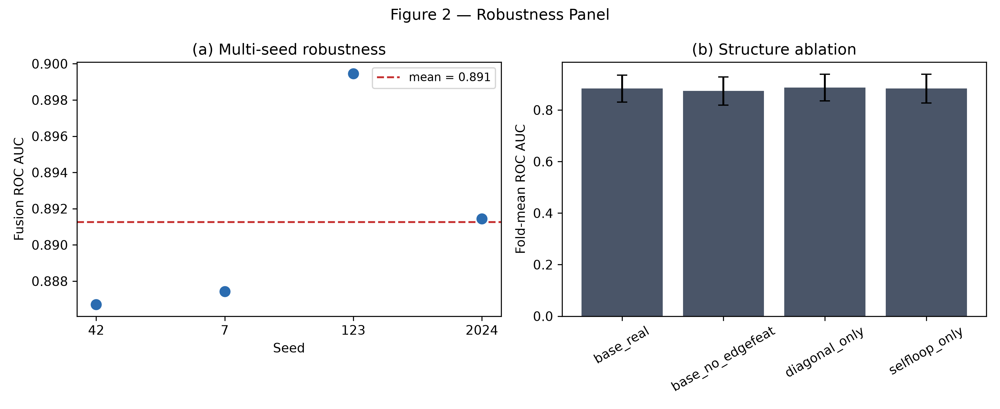
*Fig 2 — Multi-seed fusion AUC and structure-ablation fold means.*

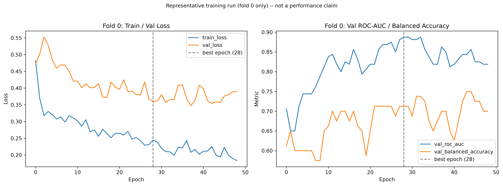
*Fig 5 — Representative training curve (fold 0): steady convergence, early stop at epoch 48.*

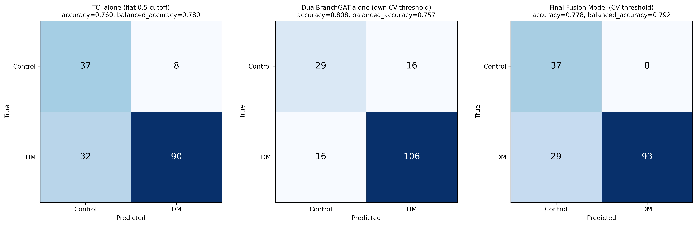
*Fig 6 — TCI alone vs GAT alone vs final fusion.*

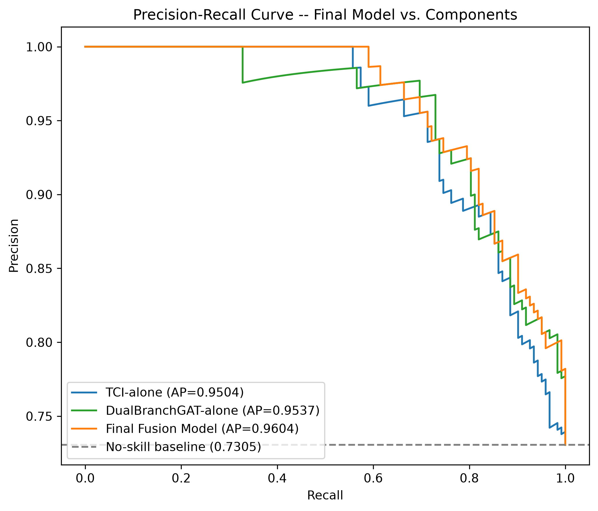
*Fig 7 — Precision-recall curves against the 0.731 no-skill line.*

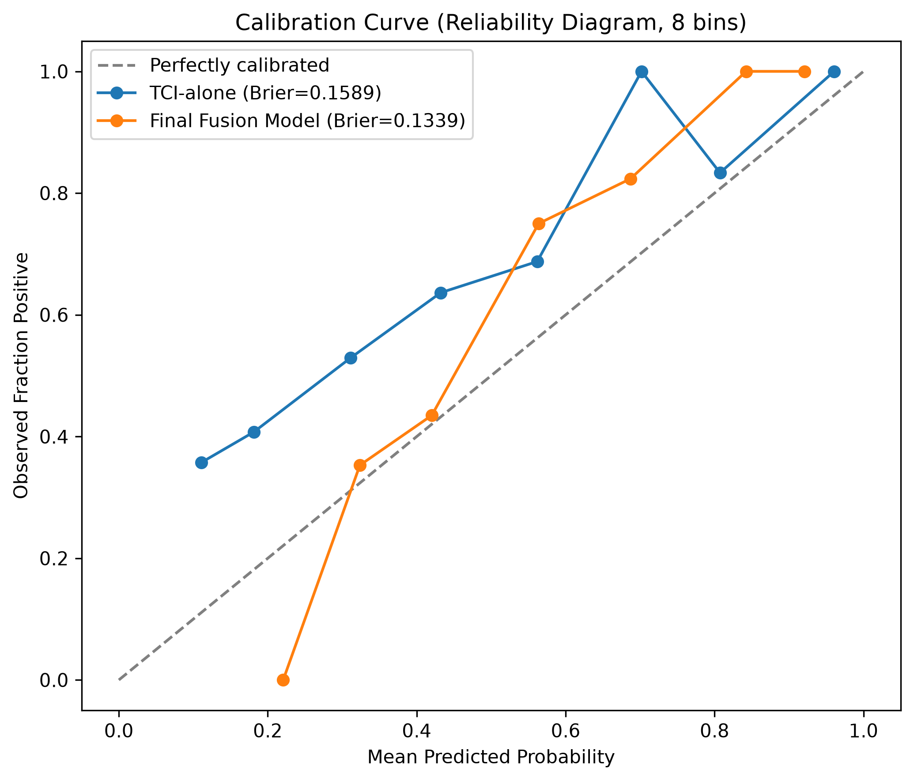
*Fig 8 — Reliability diagram: fusion vs TCI.*

</div>

</details>

---

## 🚀 Run it yourself

**1. Set up**

```bash
git clone https://github.com/Harjotsingh0311/ThermoGAT.git
cd ThermoGAT
python -m venv .venv
source .venv/bin/activate          # Windows: .venv\Scripts\activate
pip install torch numpy pandas scikit-learn scipy matplotlib seaborn pillow openpyxl jupyter
```

**2. Get the data** — the dataset is **not** redistributed here. Download it free from [IEEE DataPort](https://doi.org/10.21227/tm4t-9n15), unzip it as `ThermoDataBase/`, and set the root path and metadata path variables at the top of notebook `01`.

**3. Run the notebooks in order, 01 → 25.** Notebook `01` writes `manifest.csv` with paths for *your* machine; later notebooks read from `data/processed/` instead of re-walking the raw folders. A GPU helps but isn't required (the full 4-seed robustness run took ~23 minutes on a laptop-class GPU).

> [!TIP]
> Just want the numbers? You don't need to retrain anything — every quoted result lives in `results/`, and the trained checkpoints are in `checkpoints/`.

**4. Use the building blocks** (sketch based on the module APIs):

```python
import torch
from pathlib import Path
from src.dataset import build_dataloaders, load_normalization_stats
from src.train import build_model
from src.mc_dropout import mc_dropout_predict

processed = Path("data/processed")
stats = load_normalization_stats(processed)
loaders = build_dataloaders(processed, stats, batch_size=16)

config = dict(use_graph_branch=True, use_image_branch=True, image_in_channels=3)
model = build_model(config)
model.load_state_dict(torch.load("checkpoints/primary_model_best.pt", map_location="cpu"))

batch = next(iter(loaders["val"]))
out = mc_dropout_predict(model, batch, T=30,
                         graph_topology="base", image_key="colormap_image")
print(out["mean_prob"], out["epistemic_uncertainty"])
```

---

## 🔭 What's next

- 🧪 **External validation** on an age-matched cohort — the single most valuable next step, given the age confound.
- 🤝 **Smarter fusion.** Simple averaging recovered all 11 TCI-only wins but only 8 of 19 GAT-only wins; a better combiner might keep both.
- 📏 **Per-fold normalization** and **larger validation folds** for steadier thresholds.
- 🧬 **Self-supervised pre-training** on unlabeled thermograms, to cope with the small sample size.

---

## 📖 Plain-English glossary

<details>
<summary><b>Click to expand</b></summary>

| Term | In everyday words |
|---|---|
| **Thermography** | Taking a "heat photo" — each pixel is a temperature |
| **DM / Control** | Diabetic subject / healthy comparison subject |
| **Angiosome** | A territory of skin fed by one artery. We use four on the sole: LCA, LPA, MPA, MCA |
| **TCI (Thermal Change Index)** | The existing single-number heat score per foot; our baseline to beat |
| **Graph / node / edge** | A network: dots (nodes) joined by lines (edges). Here: 4 foot regions joined by neighbour links |
| **GAT (Graph Attention Network)** | A network that learns *how much to listen to each neighbour* |
| **Edge feature** | Extra info on a link — here distance and temperature difference |
| **ROC-AUC** | Chance that the model ranks a random diabetic subject above a random control. 0.5 = coin flip, 1.0 = perfect |
| **PR-AUC** | Like ROC-AUC but focused on the positive class; compare it to the share of positives (73 % here), not 0.5 |
| **Balanced accuracy** | Average of "caught the sick" and "cleared the healthy" — fair when classes are uneven |
| **Youden's J threshold** | The cutoff that best balances catching DM and clearing controls |
| **Brier score / calibration** | How honest the probabilities are. 0.134 beats 0.159 (lower is better) |
| **MC-Dropout** | Run the model 30 times with random neurons switched off; the *spread* of answers is its uncertainty |
| **Epistemic uncertainty** | "I'm unsure because I haven't seen enough like this" |
| **Cross-validation (k-fold)** | Rotate which fifth of the subjects is hidden for testing, so every subject is tested once |
| **Data leakage** | Accidentally letting test information into training. We split by *person* so one foot can't leak the other |
| **DeLong test** | A statistical test for whether one ROC-AUC is truly higher than another on the same subjects |
| **Confound** | A hidden factor (here: age) that tracks the label and can fool a model into "cheating" |
| **Ablation** | Remove or swap one part to see how much it really contributed |

</details>

---

## 📚 Citation & credits

If this work helps you, please cite the repo (a paper is in preparation):

```bibtex
@misc{thermogat2026,
  title  = {ThermoGAT: A Physics-Informed Dual-Branch Graph Attention Network
            for Diabetic Foot Screening from Plantar Thermography},
  author = {Harjot},
  year   = {2026},
  note   = {Code and results},
  url    = {https://github.com/Harjotsingh0311/ThermoGAT}
}
```

**Dataset:** Hernández-Contreras, Peregrina-Barreto, Rangel-Magdaleno & Renero-Carrillo, *Plantar Thermogram Database for the Study of Diabetic Foot Complications*, IEEE Access 7, 161296–161307, 2019. Please cite it too and follow its usage terms.

**TCI:** Thermal Change Index from Hernández-Contreras et al., *Infrared Physics & Technology*, 2017.

**Author:** [Harjot](https://github.com/Harjotsingh0311) — B.E. Data Science & AI, Thapar Institute of Engineering & Technology, Patiala.

> [!IMPORTANT]
> **Research use only.** ThermoGAT is an academic prototype. It is not a medical device, has no external clinical validation, and must not be used to diagnose or rule out any condition.

**License:** code released under the MIT License. The dataset keeps its own license.

<div align="center">

<sub>Built with curiosity, a lot of cross-validation, and a strict "report it honestly" policy. 🌡️</sub>

</div>